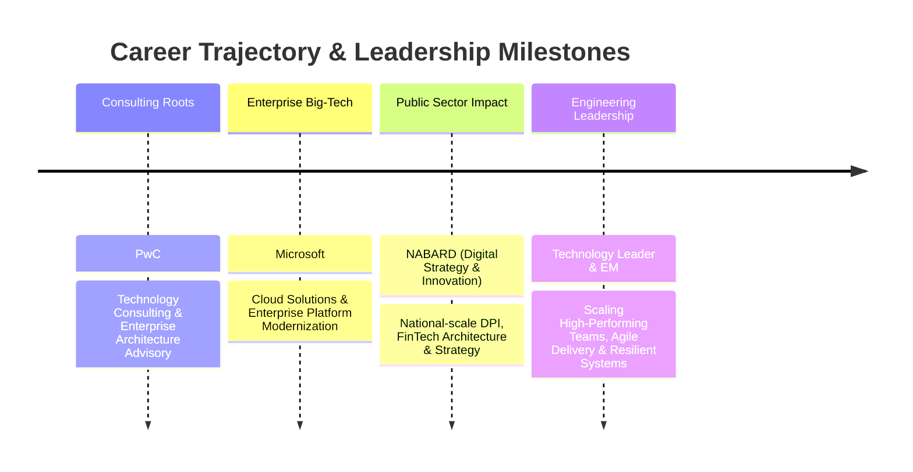

<div align="center">

  <!-- Header Banner -->
  

  <!-- Dynamic Typing Subheader -->
  <a href="https://github.com/ctrlaltvikas">
    
  </a>

  <br/>

  <!-- Profile Metrics & Badges -->
  <p>
    <a href="https://github.com/ctrlaltvikas">
      
    </a>
    <a href="https://github.com/ctrlaltvikas?tab=followers">
      
    </a>
    <a href="https://ctrlaltvikas.github.io">
      
    </a>
    <a href="https://www.linkedin.com/in/ctrlaltvikas">
      
    </a>
    <a href="https://twitter.com/ctrlaltvikas">
      
    </a>
  </p>

</div>

---

### 💻 System Information (`neofetch --profile`)

```text
       /\          Leader     : Vikas Kumar Yadav (@ctrlaltvikas)
      /  \         Role       : Rising Technology Leader & Engineering Manager
     /\   \        Core Blend : People Leadership • Project Delivery • Tech Strategy • Advisory
    /  \   \       Track      : Ex-Microsoft ☁️  |  Ex-PwC 💼  |  NABARD (Digital Strategy & Innovation)
   /    \  /       Scale      : National-scale Digital Public Infrastructure (DPI) & Agri-FinTech
  /  /\  \/        Philosophy : Empower autonomous teams, build resilient systems, deliver measurable impact
 /  /  \           Toolkit    : Distributed Systems, Agile/Scrum, OKRs, Cloud Native & DevEx
                   Terminal   : zsh + Awesome-Bash-Aliases ⚡
```

---

### 🎯 Leadership Profile & Core Pillars

I am a **technology leader** and **aspiring Engineering Manager** with a proven cross-functional track record bridging **enterprise software engineering**, **people management**, **agile project delivery**, and **strategic technology consulting**.

With foundational experience at **Microsoft** and **PwC**, coupled with driving large-scale digital initiatives at **NABARD** (Department of Digital Strategy & Innovation), I specialize in aligning engineering teams with high-impact organizational missions.

<table width="100%">
  <tr>
    <td width="50%" valign="top">
      <h4>👥 People Leadership & Team Building</h4>
      <ul>
        <li><b>Talent Coaching & Mentorship:</b> Mentoring software engineers, designing individual growth plans, and establishing high-trust engineering cultures.</li>
        <li><b>Psychological Safety & Autonomy:</b> Cultivating blameless post-mortem cultures, continuous feedback loops, and distributed decision-making.</li>
        <li><b>Cross-Functional Alignment:</b> Bridging engineering, product, legal, compliance, and executive stakeholders to maintain organizational momentum.</li>
      </ul>
    </td>
    <td width="50%" valign="top">
      <h4>🎯 Project Delivery & Agile Execution</h4>
      <ul>
        <li><b>Predictable Delivery:</b> Championing Agile/Scrum/Kanban methodologies, sprint planning, backlog grooming, and velocity optimization.</li>
        <li><b>Roadmapping & Risk Mitigation:</b> Translating multi-year business strategies into clear technical milestones, managing dependencies, and unblocking teams.</li>
        <li><b>Metrics & Outcomes:</b> Establishing OKRs, KPIs, delivery predictability, and engineering health metrics (DORA, SLA/SLO compliance).</li>
      </ul>
    </td>
  </tr>
  <tr>
    <td width="50%" valign="top">
      <h4>🧭 Technology Strategy & Advisory</h4>
      <ul>
        <li><b>Digital Transformation:</b> Modernizing legacy architectures into resilient, cloud-native digital public infrastructure.</li>
        <li><b>Consulting Craft:</b> Applying PwC & Microsoft enterprise rigor to vendor evaluations, ROI analysis, and C-suite technical advisory.</li>
        <li><b>Public Sector Innovation:</b> Architecting population-scale API ecosystems and civic platforms delivering nationwide societal value.</li>
      </ul>
    </td>
    <td width="50%" valign="top">
      <h4>🏗️ Architecture & Engineering Excellence</h4>
      <ul>
        <li><b>Distributed Systems:</b> Scalable microservices, event-driven patterns, and resilient API gateways.</li>
        <li><b>DevEx & Quality:</b> Driving automated testing, CI/CD, GitOps, and technical debt reduction strategies.</li>
        <li><b>Security & Governance:</b> Enforcing Zero-Trust architecture, data governance, and regulatory compliance (FinTech/GovTech).</li>
      </ul>
    </td>
  </tr>
</table>

---

### 💼 Career Snapshot & Trajectory



* **🏛️ National Bank for Agriculture and Rural Development (NABARD)** — *Digital Strategy & Innovation*
  * Driving national-scale digital initiatives, interoperable API standards, and civic architecture transforming public finance and rural ecosystems.
* **☁️ Microsoft** — *Enterprise Cloud & Digital Solutions*
  * Advised on cloud modernization, enterprise architectural adoption, and modern engineering practices.
* **💼 PricewaterhouseCoopers (PwC)** — *Technology & Management Consulting*
  * Advised enterprise leadership on digital roadmap strategy, IT governance, system integration, and vendor delivery management.

---

### 🌟 Featured Open-Source & Community Leadership

<table>
  <tr>
    <td width="50%" valign="top">
      <h3 align="center">⚡ <a href="https://github.com/ctrlaltvikas/Awesome-Bash-Aliases">Awesome-Bash-Aliases</a></h3>
      <p align="center">
        <a href="https://github.com/ctrlaltvikas/Awesome-Bash-Aliases/stargazers">
          
        </a>
        <a href="https://github.com/ctrlaltvikas/Awesome-Bash-Aliases/network/members">
          
        </a>
      </p>
      <p><b>Developer Productivity & Command-Line Ergonomics</b></p>
      <p>A curated collection of battle-tested Bash and Zsh aliases empowering thousands of developers worldwide to accelerate workflows and eliminate repetitive toil.</p>
      <p><b>Focus:</b> <code>DevEx</code> <code>Shell Automation</code> <code>Unix Ergonomics</code> <code>Open Source</code></p>
    </td>
    <td width="50%" valign="top">
      <h3 align="center">🇮🇳 <a href="https://github.com/ctrlaltvikas/Indian-government-API-List">Indian-government-API-List</a></h3>
      <p align="center">
        <a href="https://github.com/ctrlaltvikas/Indian-government-API-List/stargazers">
          
        </a>
        <a href="https://github.com/ctrlaltvikas/Indian-government-API-List/network/members">
          
        </a>
      </p>
      <p><b>Civic Tech & Digital Public Goods Ecosystem</b></p>
      <p>The definitive open catalog of official Government of India APIs, democratizing access to national digital infrastructure for civic hackers, startups, and researchers.</p>
      <p><b>Focus:</b> <code>Digital Public Infrastructure (DPI)</code> <code>Civic Tech</code> <code>REST APIs</code></p>
    </td>
  </tr>
  <tr>
    <td colspan="2" align="center">
      <b>Digital Garden & Leadership Notes:</b> <a href="https://ctrlaltvikas.github.io">ctrlaltvikas.github.io</a> — Writing on engineering management, digital public infrastructure, and software craftsmanship.
    </td>
  </tr>
</table>

---

### 🛠️ Comprehensive Tech Stack & Digital Arsenal

<div align="center">

#### 👥 Engineering Leadership, Agile Delivery & Product Management
<p>
  
  
  
  
  
  
</p>

#### 🧭 Technology Strategy, Consulting & Domains
<p>
  
  
  
  
  
  
</p>

#### 🏗️ Architecture, Distributed Systems & Cloud Platforms
<p>
  
  
  
  
  
  
  
  
</p>

#### 💻 Languages, APIs & Frameworks
<p>
  
</p>
<p>
  
  
  
  
  
</p>

#### 🧰 Management Tools, Observability & Productivity
<p>
  
  
  
  
  
  
  
  
  
  
</p>

</div>

---

### 📊 GitHub Activity & Analytics

<div align="center">

  <!-- Main GitHub Stats Card -->
  <a href="https://github.com/ctrlaltvikas">
    
  </a>
  <!-- Most Used Languages Card -->
  <a href="https://github.com/ctrlaltvikas">
    
  </a>

  <br/><br/>

  <!-- GitHub Contribution Streak -->
  <a href="https://github.com/ctrlaltvikas">
    
  </a>

</div>

---

### 🐍 Contribution Activity Stream

<div align="center">
  <picture>
    <source media="(prefers-color-scheme: dark)" srcset="https://raw.githubusercontent.com/ctrlaltvikas/ctrlaltvikas/output/github-contribution-grid-snake-dark.svg" />
    <source media="(prefers-color-scheme: light)" srcset="https://raw.githubusercontent.com/ctrlaltvikas/ctrlaltvikas/output/github-contribution-grid-snake.svg" />
    
  </picture>
</div>

---

### 📬 Connect & Collaborate

Whether you are looking to exchange ideas on **Engineering Leadership**, **Scaling High-Performing Teams**, **Digital Public Infrastructure (DPI)**, or **Modern Architecture & Agile Governance**, let's connect!

<div align="center">

  <a href="https://www.linkedin.com/in/ctrlaltvikas" target="_blank">
    
  </a>
  &nbsp;
  <a href="https://twitter.com/ctrlaltvikas" target="_blank">
    
  </a>
  &nbsp;
  <a href="mailto:vikasharry03@gmail.com">
    
  </a>
  &nbsp;
  <a href="https://ctrlaltvikas.github.io" target="_blank">
    
  </a>
  &nbsp;
  <a href="https://github.com/ctrlaltvikas" target="_blank">
    
  </a>

</div>

<br/>

<div align="center">
  <sub>⚡ Engineered with precision for <b>@ctrlaltvikas</b> • Empowering teams & scaling impact 🚀</sub>
</div>
